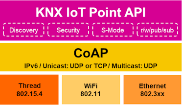

# KNX IoT Point API Stack

[](https://gitlab.knx.org/public-projects/knx-iot-point-api/knx-iot-point-api-stack/-/pipelines)
[](LICENSE.md)
[](https://cmake.org/)

This repository contains the C-based KNX IoT Point API stack used by device applications and demo projects. For a conceptual overview, see also [Build with KNX IoT](https://buildwithknxiot.knx.org/public-projects/knx-iot-docs/).

A common stack introduction and ETS6 commissioning guidance is available on the [KNX IoT documentation pages](https://buildwithknxiot.knx.org/public-projects/knx-iot-docs/). The stack is typically consumed by the [KNX IoT Point API Demos](https://gitlab.knx.org/public-projects/knx-iot-point-api/knx-iot-point-api-demos), while this repository is the implementation and test surface for the reusable core.

## What Is This?

The [Point API Schema](https://gitlab.knx.org/public-projects/knx-iot-point-api/knx-iot-point-api-schema) provides a mapping of KNX application data to a RESTful resource model and CBOR/JSON-based data representation. Devices use this representation to communicate over CoAP/UDP and IP. The Point API contains the following building blocks: Discovery, Security, S-Mode messaging and read/write/subscribe access to parameter and diagnostic properties.



**Discovery** — resource discovery over CoAP unicast/multicast or mDNS. A well-known resource URI returns links to the functional blocks and properties hosted by a server, filtered by attributes.

- Device discovery via DNS-SD and mDNS (RFC 6762)
- Semantic discovery of functional blocks per KNX Volume 7

**Security** — OSCORE secure group communication and property access.

- OSCORE (RFC 8613) for application-layer security across unicast, multicast, and low-latency communication
- SPAKE2+ (RFC 9383) for password-based mutual authentication and session key derivation (PASE)

**Point Read/Write/Publish/Subscribe** — each parameter and diagnostic property (sensor, actuator, setpoint, diagnostic value) has a unique URI for direct access (GET), update (PUT), or subscription (Observe).

- Interoperable with non-KNX systems via standard CoAP (RFC 7252)
- Flexible content formats: CBOR (RFC 8949) and JSON (RFC 8259)

**Group Communication (S-Mode)** — a producer sends a message to notify consumers of a change; no direct response is required, and any response arrives as a separate group event. ETS configures group events via group tables.

- Integrates with KNX Classic and is compatible with ETS
- CoAP/UDP for resource-constrained devices, with efficient memory and message-size handling
- Unicast and multicast over CoAP/UDP for low-latency applications

## Features

- **Client and Server APIs** for KNX IoT applications, resources, discovery, and device services
- **Tailored CoAP Stack** with Core Link Format and CBOR support for Point API resource exchange
- **OSCORE Security** resource handlers and crypto integration for secured communication
- **mDNS / DNS-SD Support** including KNX IoT specific subtypes such as `'_pm._sub._knx._udp.local.'`
- **Portable Platform Layer** for logging, clocks, random data, storage, and network integration
- **Multi-Platform Ports** for Windows, Linux, and Zephyr, with FreeRTOS documented separately
- **Standalone Test Infrastructure** with Google Test unit tests and Python runtime conformance tests

## Contributing

Improvements are welcome. Please read the [Contributing Guide](CONTRIBUTING.md) before submitting changes.

## License

[Apache License Version 2.0](LICENSE.md)

## Quick Start

**Looking for a runnable application?** The fastest path is usually the [KNX IoT Point API Demos](https://gitlab.knx.org/public-projects/knx-iot-point-api/knx-iot-point-api-demos), which consume this stack via CMake `FetchContent` and include end-to-end usage flows.

For standalone stack builds, local development, or test execution, use the setup below.

### Prerequisites

- **CMake** 3.21 or newer
- **Ninja** generator
- **A supported C/C++ toolchain**: MSVC, GCC, or MinGW cross-compilation depending on the preset
- **Python** and **Docker** if you want to run the runtime conformance suite

### Building

The project ships with [CMake Presets](https://cmake.org/cmake/help/latest/manual/cmake-presets.7.html) for Windows, Linux, cross-compilation, and test builds.

```bash
cmake --list-presets
cmake --preset <preset-name>
cmake --build --preset <preset-name>
```

Common examples:

```bash
cmake --preset linux-debug-gcc
cmake --build --preset linux-debug-gcc
```

Test-enabled presets are also available, including `windows-test-gcc`, `linux-test-gcc`, and `linux-test-asan`.

### Usage

This repository primarily builds the reusable stack library and supporting test binaries. Device applications typically include it as a dependency rather than running it directly. For application-level workflows, ETS6 commissioning, and example devices, see the [KNX IoT Point API documentation pages](https://buildwithknxiot.knx.org/public-projects/knx-iot-docs/pointapi/introduction/) and the demos repository.

## Running Tests

### Unit Tests

Enable tests with one of the `*-test-*` presets, build, and run CTest:

```bash
cmake --preset linux-test-gcc
cmake --build --preset linux-test-gcc
ctest --preset linux-test-gcc
```

Replace the preset name with the matching GCC or Linux test preset as needed.

### Runtime Conformance Tests

Runtime tests exercise the full stack over real CoAP/OSCORE on IPv6 and build a `runtime_test_server` device under test. The recommended path is the Docker-based runner described in `tests/runtime/README.md`.

```powershell
.\tests\runtime\run-in-docker.ps1
```

Useful variants:

```powershell
.\tests\runtime\run-in-docker.ps1 -k "5_4"
.\tests\runtime\run-in-docker.ps1 tests/runtime/runtime_tests/test_observe.py -x
```

For Linux or CI-style local runs, see `tests/runtime/run-local-ci.sh`.

### Fuzz Tests

The fuzz tier runs libFuzzer harnesses (`tests/fuzz/`) against the parsers that process attacker-controlled bytes before any credential check: CoAP and OSCORE option parsing, the CBOR `oc_rep` tree, mDNS, blockwise reassembly, the hex/base64/UUID/timestamp decoders and several resource handlers. It needs clang; the seed corpus is generated into the build tree by `make_corpus.py`, so no binary blobs are committed.

```bash
cmake --preset linux-fuzz-clang
cmake --build --preset linux-fuzz-clang
ctest --preset linux-fuzz-clang
```

CTest replays every seed exactly once (`-runs=0`) under the `fuzz` label, so the gating run is deterministic. To actually mutate, run a harness directly with its corpus:

```bash
cd build/linux-fuzz-clang/tests/fuzz
./fuzz_coap_parse corpus/coap_parse -max_total_time=300
```

New crashes land in `artifacts/`. In CI, `linux-fuzz-coverage` gates on the seed replay and reports source coverage; `linux-fuzz-explore` is a manual longer mutation run.

## Project Structure

```text
api/                     client/server APIs, resource handlers, KNX helpers, CBOR utilities
include/                 public headers for the stack APIs and helpers
messaging/coap/          tailored CoAP implementation and OSCORE message handling
security/                OSCORE and SPAKE2+ security implementation
util/                    low-level internal primitives used by the core framework
port/                    shared platform abstractions and OS-specific adaptations
  linux/                 Linux port
  windows/               Windows port
  zephyr/                Zephyr port
tests/unit/              Google Test unit tests
tests/runtime/           Python/pytest runtime conformance suite and DUT runner
tests/fuzz/              libFuzzer harnesses for the pre-authentication parsers
tests/docs/              runtime test walkthroughs and supporting notes
docs/                    stack documentation and migration guides
cmake/                   helper CMake modules and toolchain files
```

Key areas:

- **`api/`** implements client/server APIs, resources, endpoint handling, discovery, and CBOR encode/decode helpers for data points and function blocks.
- **`messaging/coap/`** contains the CoAP engine tailored for the stack.
- **`security/`** contains the security model implementation, including OSCORE.
- **`include/oc_api.h`** exposes the main client/server APIs.
- **`include/oc_rep.h`** provides CBOR encode/decode helpers.
- **`include/oc_helpers.h`** contains utilities for strings and arrays backed by heap or memory pools.
- **`port/*.h`** defines shared abstractions for DNS-SD, clocks, logging, randomness, storage, and networking.

## Further Documentation

| Document | Description |
| -------- | ----------- |
| [KNX IoT documentation pages](https://buildwithknxiot.knx.org/public-projects/knx-iot-docs/) | Stack introduction, ETS6 workflows, and broader Point API documentation |
| [tests/runtime/README.md](tests/runtime/README.md) | Runtime conformance test setup and execution |
| [tests/docs/runtime-test-walkthrough.md](tests/docs/runtime-test-walkthrough.md) | Walkthrough of the runtime test environment |
| [docs/mbedtls_3.x_to_4.x_migration.md](docs/mbedtls_3.x_to_4.x_migration.md) | Migration notes for Mbed TLS 4.x |
| [CONTRIBUTING.md](CONTRIBUTING.md) | Contribution workflow and CLA |

## Technologies Used

- C and CMake
- CoAP, Core Link Format, and CBOR
- OSCORE and SPAKE2+
- [Mbed TLS](https://github.com/Mbed-TLS/mbedtls) (crypto library for OSCORE and SPAKE2+)
- [TinyCBOR](https://github.com/intel/tinycbor)
- Google Test for unit tests
- Python and pytest for runtime conformance tests
