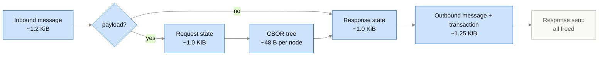
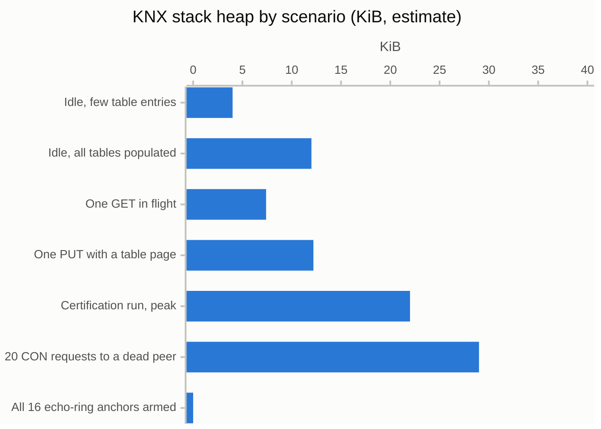
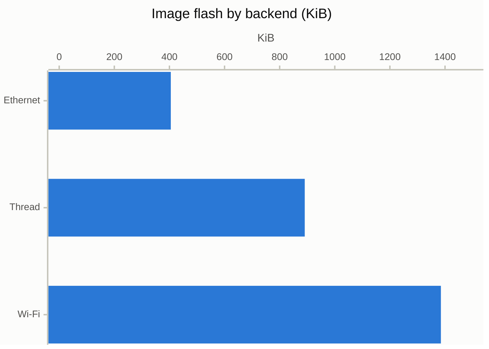
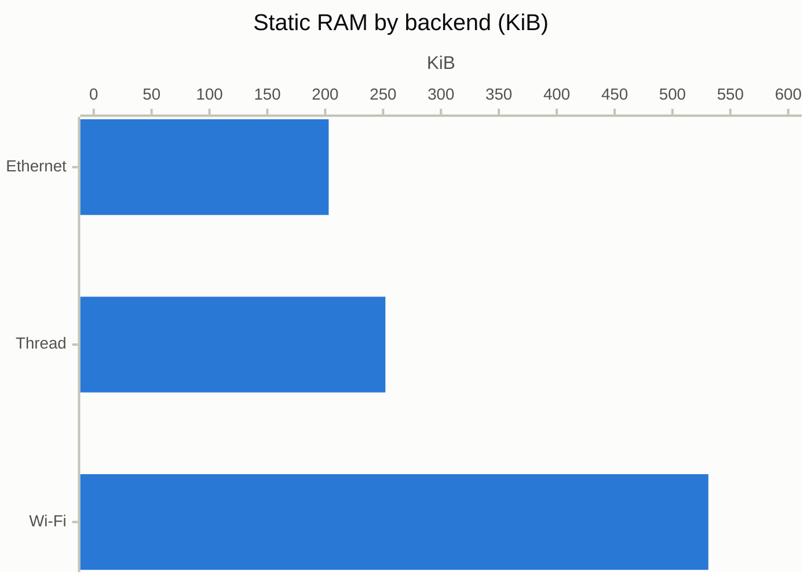
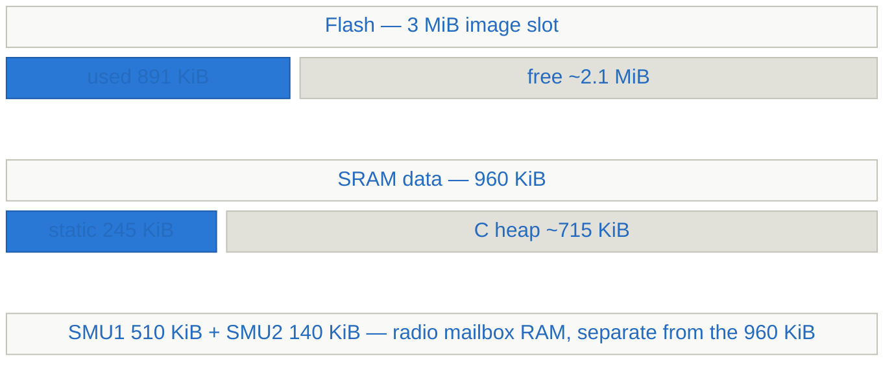
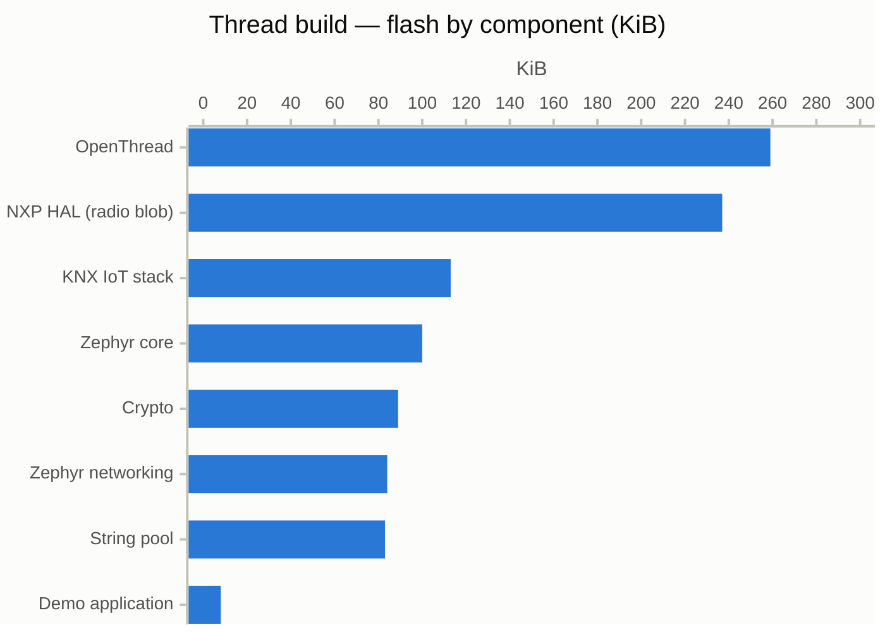
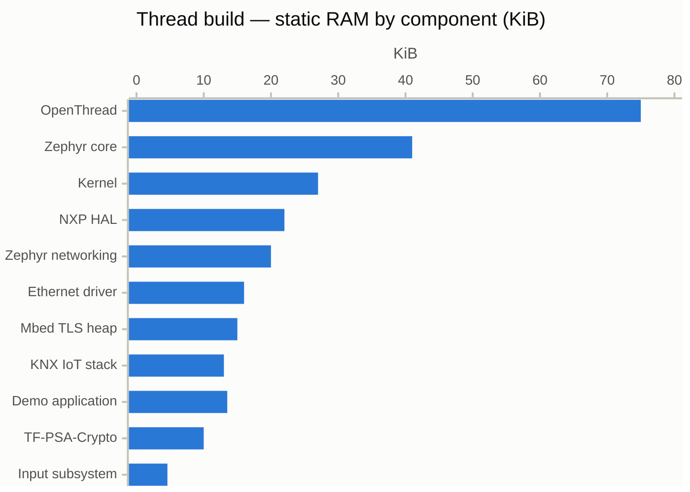

# KNX IoT Point API Stack — Memory Footprint

## 1. Conditions

Every figure in this document holds for the build described below and will
move as the stack evolves. For a first estimate it is sufficient.

| Condition | Value used here |
| --- | --- |
| Stack revision | `7c3603c` (`KNX_PAYLOAD_SIZE` 768 B, CoAP PDU 1041 B), newer than release v1.1.0 |
| Estimated since | latest change `6a76097e` (2026-10-12, diffed from `72dd0f88`): the `oc_core_set_and_store_device_*` setters return an errno code and write NVM first (RAM only changes if the write succeeded), the optional PUT handlers of `/dev/iid` and `/dev/fid` are removed, the DNS-SD update takes the device info instead of four values and is postponed until the stack is initialized, the shell commands are refused while the stack is not running, the SRP port drops its `host_named` flag, and the config fingerprint is 4 B instead of 8 B (`g_fingerprint`, persisted record 8 to 4 B). Net code change by the report's densities: KNX resources -12 lines x 5.9 B/line = -0.07 KiB, core +38 x 4.5 = +0.17 KiB, shell +19 x 10 = +0.19 KiB, mDNS +10 x 7.3 = +0.07 KiB (Ethernet, Wi-Fi), SRP +21 x 5.5 = +0.11 KiB (Thread), `connectivity_posix` -4 lines = -0.03 KiB (Ethernet, Wi-Fi), so about +0.34 KiB (Ethernet, Wi-Fi) and +0.41 KiB (Thread), below 0.5 KiB. Static RAM about -5 B (`g_fingerprint` -4 B, `host_named` -1 B). New error and shell strings about 0.65 KiB go to the image string pool (§ 5), not to the stack rows. No figure moved. Before that, `72dd0f88` (2026-10-07, diffed from `da465868`, with `d4291510` and `cf33c7f0`): the optional `/dev/hname` PUT handler and the hostname application callback are removed, the hostname is a DNS label without `.local` (the domain is appended for `/dev/hname` and mDNS), it is stored again and set by `oc_core_set_device_hostname()` with a DNS-SD re-announcement, and the Zephyr SRP port keeps a second 64 B hostname buffer (`pending_hostname`) so a runtime change reaches the Thread registration. Net code change below 0.5 KiB (about +15 non-comment lines), static RAM +55 B on Thread (+64 B pending buffer, -1 B smaller hostname buffer, -8 B removed callback record), -8 B on Ethernet and Wi-Fi, stack use of the mDNS hostname buffers +8 B, so no figure moved. Before that, `da465868`: the Partial IV buffers shrink from 5 to 4 bytes (`OSCORE_PIV_LEN` = `OSCORE_SSN_PIV_LEN_MAX`, the AEAD nonce keeps its fixed 5-byte PIV field), so `OSCORE_MAX_OPTION_VALUE_LEN` and the outer header reserve drop by 1 B (54 to 53 B, total 273 to 272 B) and the default PDU is 768 + 272 = 1 040 B instead of 1 041 B (§ 7.1); the `piv` arrays of `oc_endpoint`, `coap_packet_t` and `oc_client_cb` shrink by 1 B each, the real 32-bit `sizeof` effect (at most a few bytes of padding) was not measured; per message buffer about 1 to 4 B, no other figure moves. Before that, `68c2e9a7` (simplified PIV/SSN conversion functions) plus the uncommitted SSN exhaustion handling (the OSCORE sender refuses to send at `OSCORE_SSN_MAX`, the startup padding saturates instead of wrapping), diffed from `d60d4349`: net code change about +0.1 KiB, about 0.15 KiB of INFO-level log strings (not in the stack rows, § 5), no static RAM change, so no figure moved. Before that, figures marked `~` estimated for the 32-bit SSN change on `memory_footprint_optimization` (`d60d4349`, diffed from `fa57de3e`): the OSCORE sender sequence number is `uint32_t` instead of `uint64_t` (KNX IoT 32-bit SSN space). On 32-bit this shrinks the echo slot from 48 to 36 B (§ 6, § 8) and the OSCORE context from 144 to 136 B (§ 7.2). The replay record computes to 48 B with the reordered fields (§ 6). The persisted SSN record per access token is 4 B instead of 8 B (no migration, old records read as missing). Flash change is below rounding. Before that, `fa57de3e` (2026-10-01) was diffed from `e86c2dd6`: S-Mode/Echo and `/k` hardening added ~0.6 KiB of code to the KNX resources area (§ 5, § 2.1, § 9.1). The echo slot struct changed shape (the retained-message pointer became a group object table reference, plus a service-type byte) but stayed 48 B on 32-bit, and § 7.2 / § 7.4 already describe the heap-free ring. Before that, `e86c2dd6` was diffed from `9f1f59db`: the echo ring no longer retains a plaintext `oc_message_t` per anchor (§ 6, § 7.2, § 7.4, § 8). Before that, `9f1f59db` was diffed from `7c3603c`
| Echo ring size | Zephyr's `CONFIG_KNXIOT_ECHO_RING_SIZE` default lowered from 64 to 16 (2026-09-24) when an anchor still pinned a ~1.19 KiB plaintext copy. Since `e86c2dd6` an anchor holds only a reference to the originating group object table entry and regenerates the re-request payload on demand, so the ring no longer retains heap at all and its cost is the slot struct alone, see § 7.2, § 7.4, § 8. Other ports still default to 64 via the top-level CMake `KNX_ECHO_RING_SIZE`. Figures below use the Zephyr default of 16 and are estimated (`~`), not yet re-measured on a device |
| Toolchain and RTOS | Zephyr 4.4.1, GCC 12, `-Os`, 32-bit Cortex-M33 |
| Configuration | **Development**: shell and OpenThread CLI on, 24 KiB log buffer, INFO-level logging, OpenThread diagnostics on. Production values are estimates, marked as such (§ 4) |
| KNX table sizes | certification defaults: 50 group objects, 20 publishers, 20 recipients, 20 access tokens |
| Application | EITT certification demo, 5 datapoints |
| Boards measured | NXP FRDM-RW612 (Ethernet, Wi-Fi, Thread), NXP FRDM-MCXW72 (Thread, 256 KB RAM) |
| Measured vs estimated | Flash and static RAM: measured from the linked images. Heap: estimated from the allocation model (§ 7), confirm on a device with `knx_iot malloc_heap` |
| Other targets | Other 32-bit MCUs land close to these numbers; 64-bit hosts run larger because pointer-heavy structs roughly double |

## 2. What you need

### 2.1 The KNX IoT stack alone

| | Ethernet, Wi-Fi | Thread |
| --- | --- | --- |
| **FLASH** | ~126 KiB | ~111 KiB |
| **RAM, static** | ~30 KiB | ~13 KiB |
| **RAM, stack thread** | 12 KiB | 12 KiB |
| **RAM, crypto heap (Mbed TLS)** | 15 KiB | 15 KiB |
| **RAM, heap, idle → certification peak** | 4 → ~24 KiB | 4 → ~24 KiB |
| **RAM, total** | **~61–81 KiB** | **~44–64 KiB** |

The flash and static RAM difference between the two columns is the discovery
mechanism (§ 3).
"Certification peak" is the heaviest moment of a KNX IoT
conformance run with the EITT tool, three requests overlapping plus one pending
ACK and one notification; it is the realistic upper bound for normal operation
and is itemised in § 7.4.

### 2.2 A complete device

The stack is a small part of a device image. These are **complete firmware
images**: Zephyr kernel, shell, logging, settings and flash storage, the Zephyr
network stack, Mbed TLS and PSA crypto, the vendor HAL with its radio firmware,
the network backend (OpenThread, or the Wi-Fi driver with the WPA supplicant),
the demo application and the KNX IoT stack. The network backend decides most of
the total.

| Backend, board | FLASH, development | FLASH, production est. | RAM static, development | RAM static, production est. | Fits |
| --- | --- | --- | --- | --- | --- |
| Ethernet, RW612 | **~405 KiB** | ~340 KiB | **~203 KiB** | ~175 KiB | 512 KiB flash, 320 KiB RAM class MCU |
| Thread, RW612 | **~890 KiB** | ~790 KiB | **~253 KiB** | ~215 KiB (~200 as MTD) | 1 MiB flash, 384 KiB RAM; 214 KiB of the flash is radio firmware |
| Thread, MCXW72 | **~612 KiB** | ~510 KiB | **~205 KiB** of 232 usable | ~165 KiB | a 256 KB part works; ~27 KiB heap left in development, ~65 KiB in production |
| Wi-Fi, RW612 | **~1.4 MiB** | ~1.3 MiB | **~533 KiB** | ~490 KiB | 2 MiB flash, 768 KiB RAM; 351 KiB radio firmware plus WPA supplicant |

MTD: Minimal Thread Device, a non-routing end device; the measured builds are
Full Thread Devices that can route.

Of these totals the KNX stack is ~111-126 KiB of flash and ~13-30 KiB of static
RAM (§ 2.1); everything else is platform: Zephyr and its subsystems, crypto,
and the backend (§ 9.2 breaks it down). Add the C heap on top of static RAM:
the stack alone peaks at ~24 KiB, the network stacks take more, and a
comfortable device leaves 100 KiB or more.

## 3. Why the numbers differ

**The backend, not the stack, sets the size of a device.** Ethernet needs no
radio firmware. Thread adds OpenThread (~260 KiB flash, ~75 KiB RAM) and a
214 KiB radio firmware blob on the RW612. Wi-Fi adds a 351 KiB radio firmware
blob, the Wi-Fi driver, the WPA supplicant and IPv4/TCP support, together about
1 MiB of flash and 300 KiB of RAM more than Ethernet. The KNX stack is the same
code in every image.

**Discovery costs the stack 15 KiB of flash and 17 KiB of RAM more on Ethernet
and Wi-Fi than on Thread.** Every KNX IoT device must be discoverable by
DNS-SD. On Ethernet and Wi-Fi the device is its own mDNS responder: a small DNS
server with a listener thread, packet buffers and a socket, identical on both.
On Thread the device registers once with the border router's SRP server, and
the router's advertising proxy publishes the records as mDNS on the LAN;
OpenThread already contains the SRP client, so the port needs ~2 KiB and no
buffers or thread. What a PC on the LAN sees is the same in every case.

**Development versus production is worth 60–100 KiB of flash and 30–40 KiB of
RAM.** Shell, OpenThread CLI, log buffer, INFO-level log strings and
OpenThread diagnostics are tooling; § 4 lists each item, its cost and the
switch that removes it.

---

## Details

## 4. Development versus production configuration

Every number in this document was measured with the development configuration
the demo applications ship with. It is already compiled with `-Os`; what makes
it "development" is the tooling left switched on. No production build has been
measured, so the savings below are estimates from the component sizes in § 9.

| Development item | Flash | RAM | Turned off by |
| --- | --- | --- | --- |
| Zephyr shell with KNX and kernel commands | ~20 KiB | ~6 KiB (shell stack, context) | `CONFIG_SHELL=n` |
| OpenThread CLI (Thread only) | ~30 KiB | ~1 KiB | `CONFIG_OPENTHREAD_SHELL=n` |
| Log ring buffer 24 KiB → 4 KiB | — | ~20 KiB | `CONFIG_LOG_BUFFER_SIZE` |
| INFO-level log strings (the image-wide string pool, § 5) | ~30–60 KiB | — | `CONFIG_LOG_DEFAULT_LEVEL=2`, `CONFIG_KNXIOT_LOG_LEVEL=2` |
| OpenThread diagnostics: link metrics, time sync, ping (Thread only) | ~5 KiB | ~2 KiB | `CONFIG_OPENTHREAD_LINK_METRICS_*=n`, `_TIME_SYNC=n`, `_PING_SENDER=n` |
| Full Thread Device → Minimal Thread Device, if the device need not route | ~15 KiB | ~10–15 KiB | `CONFIG_OPENTHREAD_MTD=y` |
| NVS lookup cache 1024 → 256 slots | — | ~3 KiB | `CONFIG_NVS_LOOKUP_CACHE_SIZE` |
| KNX tables sized to the product instead of the certification defaults | — | ~2–4 KiB | `CONFIG_KNXIOT_*_MAX_ENTRIES` |
| HTTP server when soft-AP provisioning is unused (Wi-Fi only) | ~27 KiB | ~11 KiB | `CONFIG_HTTP_SERVER=n` |

Applied to the § 2.2 images, a production configuration lands roughly here:

| Backend, board | Development | Production estimate |
| --- | --- | --- |
| Ethernet, RW612 | 405 KiB flash / 205 KiB RAM | ~340 KiB / ~175 KiB |
| Thread, RW612 | 890 KiB / 255 KiB | ~790 KiB / ~215 KiB, ~200 KiB as MTD |
| Thread, MCXW72 | 612 KiB / 207 KiB | ~510 KiB / ~165 KiB, leaving ~65 KiB heap instead of ~25 KiB |
| Wi-Fi, RW612 | 1.4 MiB / 535 KiB | ~1.3 MiB / ~490 KiB |

The KNX stack itself changes by 6 KiB of flash only (its shell commands). Its
RAM does not depend on the configuration beyond the table sizes.

## 5. Flash

| Area | Flash | Objects |
| --- | --- | --- |
| KNX resources (`/fp`, `/auth`, `/dev`, `/.knx`, `/p`, `/swu`) | ~46 KiB | `oc_knx_fp`, `oc_knx_sec`, `oc_knx_dev`, `oc_knx`, `oc_knx_swu`, `oc_knx_client`, `oc_knx_p`, `oc_knx_fb`, … |
| CoAP engine, blockwise, observe, transactions | ~15 KiB | `engine`, `coap`, `oc_blockwise`, `observe`, `transactions`, `separate` |
| OSCORE and SPAKE2+ | ~15 KiB | `oc_oscore_engine`, `oc_oscore_context`, `oc_oscore_crypto`, `spake2plus`, `oscore` |
| CBOR object model | ~9 KiB | `oc_rep`, TinyCBOR (parser 1.7, encoder 0.7) |
| Resource interface and core | ~12 KiB | `oc_ri`, `oc_core_res`, `oc_discovery`, `oc_main`, `oc_buffer` |
| Port, Thread | ~11 KiB | `connectivity_thread` 1.6, `dns-sd-thread` ~1.5 (DNS-SD parity rework merged), `storage`, `knx_shell` 6 |
| Port, Ethernet and Port, Wi-Fi (identical) | ~21 KiB | `connectivity_posix` 5.4, `dns-sd_mdns` 8 (mDNS responder), `storage`, `knx_shell` 6 |
| Helpers, strings, lists, timers | ~5 KiB | |

Removable without protocol impact: the shell commands (6 KiB) and software
update (5 KiB) when not needed. Everything else is exercised by certification.

String literals are not in these figures. The linker merges all mergeable
strings of the whole image, mostly log format strings, into one pool and the
map attributes it to whichever object comes first. That pool measured 53 KiB
(Ethernet), 83 KiB (Thread) and 188 KiB (Wi-Fi) on RW612, so it scales with
the image, not with the stack. Lowering `CONFIG_KNXIOT_LOG_LEVEL` and the
Zephyr log level compiles part of it out.

## 6. Static RAM

The stack owns no static message buffers. Its static RAM is tables plus two
rings, and the tables scale linearly with their configured capacity.

| Item | Bytes | With defaults | Configured by |
| --- | --- | --- | --- |
| Group object table | 28 × entries | 50 → 1.4 KiB | `CONFIG_KNXIOT_GOT_MAX_ENTRIES` |
| Publisher table | 88 × entries | 20 → 1.7 KiB | `CONFIG_KNXIOT_GPT_MAX_ENTRIES` |
| Recipient table | 88 × entries | 20 → 1.7 KiB | `CONFIG_KNXIOT_GRT_MAX_ENTRIES` |
| Auth (access token) table | ~72 × entries | 20 → ~1.4 KiB | `CONFIG_KNXIOT_ATT_MAX_ENTRIES` |
| 16 × ~36 | ~0.56 KiB |
| Request history | 32 × 32 | 1.0 KiB | fixed (`OC_REQUEST_HISTORY_SIZE`) |
| Replay records | 20 × ~48 | ~0.94 KiB | fixed |
| CoAP engine, callbacks, device info | | ~3 KiB | |
| **Subtotal, Thread** | | **~13 KiB** | |
| mDNS listener thread stack | | 8 KiB | Ethernet and Wi-Fi only |
| mDNS send and receive buffers | 2 × 2 KiB | 4 KiB | Ethernet and Wi-Fi only |
| Socket connectivity state (endpoints, interface list) | | 4.8 KiB | Ethernet and Wi-Fi only |
| **Subtotal, Ethernet, and Subtotal, Wi-Fi** | | **~30 KiB** | |

Table entries hold fixed fields only. Hrefs, token ids and group-address
arrays are allocated on the heap when an entry is written (40–120 B per
populated entry, see § 7.2).

Outside the library but part of the footprint on Zephyr: the stack thread's
stack (`CONFIG_KNXIOT_THREAD_STACK_SIZE`, 12 KiB default) and the Mbed TLS heap
(`CONFIG_MBEDTLS_HEAP_SIZE`, 15 KiB) that OSCORE and SPAKE2+ draw from.

## 7. Dynamic RAM

Three things to know before reading further:

1. **Heap use is bounded by protocol activity, not by configuration.** The
   Zephyr port defines no pool limits; lists grow until `malloc` fails.
2. **Every CoAP message costs ~1.2 KiB** and every handled request another
   ~1.0 KiB of response state. That is where the heap goes.
3. **Static RAM is a formula of the table sizes**, plus a fixed 17 KiB for the
   mDNS responder on Ethernet and on Wi-Fi, see § 6.

Everything dynamic comes from the C `malloc` heap. Sizes include ~8 B allocator
overhead per block. The figures are the same for all three backends.

### 7.1 Buffer sizes

| Constant | Value | Where |
| --- | --- | --- |
| `KNX_PAYLOAD_SIZE`, max application data | 768 B | `zephyr/CMakeLists.txt` / top-level CMake |
| CoAP header reserve per PDU | outer ~53 B + inner 219 B = ~272 B | `messaging/coap/conf.h` |
| `OC_PDU_SIZE`, one CoAP message buffer | ~1 040 B | payload + header reserve |
| On-wire block size | 512 B | largest power of two ≤ payload |
| `OC_MAX_OBSERVE_SIZE` | 512 B | port `oc_config.h` |
| CON retransmission window | 5 s × 4 retries ≈ 155 s | `messaging/coap/constants.h` |
| `OC_EXCHANGE_LIFETIME` | 318 s | `messaging/coap/constants.h` |

### 7.2 What is allocated

| Item | Bytes each | Lifetime |
| --- | --- | --- |
| CoAP message (`oc_message_t` 140 + PDU ~1 040) | ~1 190 | transient; for CON until ACK |
| Blockwise response state (164) + app buffer (768) + href | ~980 | per handled request, freed with the response |
| Blockwise request state, requests with payload | ~980 | until dispatched |
| CoAP transaction (48) | ~56 | until ACK, ≤ 155 s |
| Client callback (176) + uri/query | ~220 | until response, ≤ 318 s |
| Parsed CBOR node (`oc_rep_t` 40) + value string | ~48 + string | while the payload is handled |
| Observer (152) + URL | ~190 | while observed |
| Observe notification buffer | ~520 | transient |
| OSCORE context (~136) | ~144 | until replaced; LRU eviction only on allocation failure |
| Datapoint resource (132 + runtime data + 3 strings) | ~250 | forever, one per application datapoint |
| Table-entry strings and group-address arrays | 40–120 per entry | forever |
| OSCORE echo-ring anchor's retained plaintext (`wl.msg`, ref-counted `oc_message_t`) | ~0, was ~1 190 | **removed** since `e86c2dd6`: an anchor references the group object table entry instead and regenerates the payload on demand |
regenerates the payload from the group object |
| Unicast s-mode CON transaction (`fp/r` default) | ~1 246 (transaction ~56 + full `oc_message_t` ~1 190) | until ACK, at most `MAX_RETRANSMIT` (~45 s); the full PDU is kept for retransmission and for re-parsing on a 4.01 echo |
| Unicast s-mode echo-ring anchor (CON and NON) | 0 heap, one existing ring slot | until consumed or overwritten; added on the first send only (no anchor for CON repetitions), matches a 4.01 echo with a 10-byte kid context |

Core resources (`/dev/*`, `/fp/*`, `/auth/*`, …) are `const` and cost no heap.

The OSCORE echo ring holds no heap. An anchor records only a reference to the originating group object table entry plus the service type; when a late 4.01 echo response arrives the re-request payload is regenerated from that entry into the inbound message's own buffer. The reference cannot go stale: the ring is wiped whenever the load state machine leaves loading, which is the only state in which `/fp/g` may be written. Before `e86c2dd6` each armed anchor instead pinned a ~1.19 KiB plaintext `oc_message_t` with no timeout, so a burst of unanswered challenges retained ~19 KiB at the Zephyr default of 16 and ~74 KiB at the CMake default of 64 - the latter more than the free heap on the MCXW72 build (§ 2.2). That worst case no longer exists.

### 7.3 One request in flight



| Request | Peak heap | Held for |
| --- | --- | --- |
| GET | ~3.4 KiB | until the response leaves |
| PUT / POST | ~4.4 KiB + CBOR tree (a table page of ≤ 768 B ≈ 3.8 KiB) | until the response leaves |
| Outgoing CON | ~1.25 KiB | until ACK, worst case 155 s |

Only outgoing CON requests accumulate: a burst to a peer that never answers
keeps ~1.25 KiB per request alive for minutes.

### 7.4 Heap by scenario



| Scenario | Heap | Composition |
| --- | --- | --- |
| Idle, few table entries | ~4 KiB | 5 resources 1.2, strings ~1, OSCORE contexts ~0.5, misc |
| Idle, all 110 table entries populated | ~12 KiB | strings and GA arrays ≤ 6, 20 OSCORE contexts 3, resources |
| One GET in flight | + 3.4 KiB | |
| One PUT with a table page | + 8.2 KiB | request set + CBOR tree of one page |
| Certification run, peak | **~20–24 KiB** | three overlapping requests, one page parse, one pending ACK, one notification; itemised below |
| 20 CON requests to an unreachable peer | + 25 KiB, ≤ 155 s | |
| All 16 echo-ring anchors armed | ~0 KiB | an anchor references a group object table entry and regenerates its payload on demand, so no heap is retained, see § 7.2. Was ~19 KiB at 16 slots and ~74 KiB at 64 before `e86c2dd6` |

#### What "certification run, peak" means

The EITT conformance suite drives the device mostly one request at a time.
Overlap comes from three sources: a CON response still waiting for its ACK
while the next request arrives, an observe notification the device sends on
its own while a request is being handled, and the retransmission of a request
whose first copy is still in flight. Three requests overlapping is the
realistic worst case, and the figure assumes exactly this moment:

| Component of the peak | Heap | Why it is there |
| --- | --- | --- |
| Idle baseline during the run | ~8 KiB | 5 resources, half-populated tables and their strings, ~10 OSCORE contexts from the test's auth entries |
| One PUT/POST being handled, with payload | 4.4 KiB | inbound message, request state, response state, outbound message |
| Its CBOR tree, one table page | 3.8 KiB | ~80 nodes at 48 B plus strings for the entries a 768 B page holds |
| One GET being handled | 3.4 KiB | inbound message, response state, outbound message |
| One CON response awaiting ACK | 1.25 KiB | previous request's answer, up to 155 s |
| One observe notification in flight | 1.7 KiB | 512 B notification buffer plus the outgoing message |
| **Sum** | **~22.5 KiB** | quoted as 20–24 KiB to cover string lengths and allocator rounding |

Anything beyond this is not a certification pattern but an overload: many
unanswered CON requests (row above), a client that opens dozens of observations,
or a peer that floods requests. Those are what `proposal-resource-caps.md`
bounds.

## 8. Knobs and measurement

| Knob | Effect | Where |
| --- | --- | --- |
| `KNX_PAYLOAD_SIZE` | ±1 KiB per message and per response state | CMake |
| `CONFIG_KNXIOT_*_MAX_ENTRIES` | 28–88 B static per entry, plus strings when populated | Kconfig |
| `CONFIG_KNXIOT_ECHO_RING_SIZE` | ~36 B static per slot (48 B before the 32-bit SSN change);
| `CONFIG_KNXIOT_THREAD_STACK_SIZE` | stack thread; 12 KiB has headroom for NVS writes and SRP calls | Kconfig |
| `CONFIG_MBEDTLS_HEAP_SIZE` | SPAKE2+ needs the most; 15 KiB proven | Kconfig |
| `CONFIG_KNXIOT_LOG_LEVEL` | compiles out format strings from the image-wide string pool | Kconfig |
| `OC_MAX_NUM_CONCURRENT_REQUESTS` | not defined for Zephyr, so no cap on transactions/observers; define it in the port `oc_config.h` to bound § 7.3 accumulation on small-RAM parts | port |
| Shell, SWU | 6 KiB + 5 KiB flash | Kconfig / build |

Measuring on a Zephyr target (both heaps are instrumented when
`CONFIG_SYS_HEAP_RUNTIME_STATS=y`):

```text
uart:~$ knx_iot malloc_heap      # C heap: allocated, free, max-allocated
uart:~$ kernel heap              # Zephyr system heap (not used by the stack)
```

Read `knx_iot malloc_heap` at idle and after a certification session; the
max-allocated figure is the real peak to compare with § 7.4.

---

## 9. Example: EITT on FRDM-RW612, three network backends

Same application (`knx-iot-eitt`, 4 switch datapoints + 1 parameter), same
board, development configuration, built pristine on 2026-09-08 with the
backend selected in `apps-zephyr/boards/frdm_rw612.conf`. Measured at stack
revision `e4cb428`; the current `7c3603c` differs only in the CoAP buffer
sizes, which are heap and do not appear in these static figures. The board's
Ethernet MAC is enabled in devicetree, so the Ethernet driver is present in all
three images.

Method: image totals from `size` and `readelf` on `zephyr.elf`; per-component
and per-object attribution from the linker map `zephyr.map`, which over-counts
merged sections by ~8 %, so component figures are shares; struct sizes in § 7.2
from the debug information (`gdb`, `ptype/o`).

### 9.1 Totals





| | Ethernet | Thread | Wi-Fi |
| --- | --- | --- | --- |
| Flash used | **405 KiB** | **891 KiB** | **1 385 KiB** |
| of which radio firmware blob | — | 214 KiB (CPU2, BLE + 802.15.4) | 351 KiB (CPU1, Wi-Fi) |
| Static RAM | **~203 KiB** | **~252 KiB** | **~531 KiB** |
| of which code relocated to SRAM | 8 KiB | 8 KiB | 88 KiB |
| C heap left (of 960 KiB) | ~765 KiB | ~717 KiB | ~516 KiB |
| KNX IoT stack flash / static RAM | ~125 / ~30 KiB | ~114 / ~13 KiB | ~125 / ~30 KiB |
| KNX share of image | 31 % / ~15 % | 13 % / ~5 % | 9 % / 6 % |

The KNX stack is constant except for the discovery mechanism (§ 3). Everything else in the
spread is the network backend.

### 9.2 What each backend brings

| Component | Ethernet | Thread | Wi-Fi | Notes |
| --- | --- | --- | --- | --- |
| NXP HAL, flash | 12 KiB | 237 KiB | 588 KiB | radio blob + Wi-Fi driver (Wi-Fi) or IMU/HDLC glue (Thread) |
| NXP HAL, RAM | 13 KiB | 22 KiB | 140 KiB | Wi-Fi driver state, firmware download buffers |
| OpenThread, flash / RAM | — | 259 / 75 KiB | — | FTD core 183, CLI 30, Spinel/HDLC 35 |
| WPA supplicant (in libzephyr), flash / RAM | — | — | ~250 / ~14 KiB | `CONFIG_WIFI_NM_WPA_SUPPLICANT` |
| Zephyr networking, flash / RAM | 115 / 34 KiB | 84 / 20 KiB | 176 / 63 KiB | Wi-Fi adds IPv4, DHCPv4, TCP, HTTP server, Wi-Fi L2 |
| Kernel heap (`CONFIG_HEAP_MEM_POOL_SIZE`) | 32 KiB | 16 KiB | 64 KiB | per backend conf |
| Crypto, flash / RAM | 34 / 11 KiB | 89 / 25 KiB | 55 / 48 KiB | Thread adds Mbed TLS SSL + X.509 and the 15 KiB Mbed TLS heap; Wi-Fi adds a larger PSA key store |
| Ethernet driver, flash / RAM | 8 / 16 KiB | 8 / 16 KiB | 8 / 16 KiB | devicetree, present in all three |
| Zephyr core (shell, log, settings), flash / RAM | 48 / 41 KiB | 47 / 41 KiB | 48 / 41 KiB | identical |
| Image string pool | 53 KiB | 83 KiB | 188 KiB | log format strings of all components |
| Demo application | 8 / 13.5 KiB | 8 / 13.5 KiB | 10 / 13.7 KiB | includes the 12 KiB KNX thread stack |

Configuration that differs per backend and shows up in RAM:

| Symbol | Ethernet | Thread | Wi-Fi |
| --- | --- | --- | --- |
| `CONFIG_HEAP_MEM_POOL_SIZE` | 32768 | 16384 | 65536 |
| `CONFIG_NET_IF_MAX_IPV6_COUNT` | 1 | 1 | 2 |
| `CONFIG_NET_IPV4` / `NET_DHCPV4` / `NET_TCP` | n | n | y |
| `CONFIG_HTTP_SERVER` | n | n | y |
| `CONFIG_SYSTEM_WORKQUEUE_STACK_SIZE` | 1024 | 1024 | 8192 |
| `CONFIG_NET_MGMT_EVENT_STACK_SIZE` | 800 | — | 4200 |
| WPA supplicant thread + work queue stacks | — | — | 5800 + 4400 |
| `CONFIG_NET_MAX_CONTEXTS` / `NET_MAX_CONN` | 10 / 10 | 6 / 4 | 16 / 16 |
| `CONFIG_MBEDTLS_HEAP_SIZE` | — | 15360 | — |

### 9.3 Thread build in detail







| Component | Flash | RAM | Dominant items |
| --- | --- | --- | --- |
| OpenThread | ~259 KiB | ~75 KiB | OT instance 50, driver buffer 8.8, OT thread stack 8, iface buffer 4.9 |
| NXP HAL | 237 KiB | ~22 KiB | **214 KiB CPU2 radio firmware**, IMU stacks 4, lookup tables 8 |
| KNX IoT stack | 113 KiB | ~13 KiB | § 5, § 6 |
| Zephyr core | ~100 KiB | ~41 KiB | log ring buffer 24, settings/NVS 5, shell stack 5 |
| Crypto | ~89 KiB | ~25 KiB | TF-PSA-Crypto 57, Mbed TLS 24, X.509 8; Mbed TLS heap 15 |
| Zephyr networking | ~84 KiB | ~20 KiB | net_buf pools 8, packet slabs 2.5, RX/TX stacks 2.7 |
| Kernel | 12 KiB | ~27 KiB | system k_heap 16, main stack 6, ISR stack 2 |
| Ethernet driver | 8 KiB | 16 KiB | RX/TX buffers; drop with a `frdm_rw612_thread.conf` setting `CONFIG_NET_L2_ETHERNET=n` |
| Demo application | 8 KiB | 13.5 KiB | KNX stack thread stack 12 |

### 9.4 System-level knobs

| Knob | Saves | Symbol |
| --- | --- | --- |
| OpenThread CLI | 30 KiB flash | `CONFIG_OPENTHREAD_SHELL=n` |
| Ethernet driver in the Thread/Wi-Fi image | 8 KiB flash, 16 KiB RAM | `CONFIG_NET_L2_ETHERNET=n` in a `<board>_<backend>.conf` |
| Log ring buffer | up to 20 KiB RAM | `CONFIG_LOG_BUFFER_SIZE` |
| Log levels | tens of KiB of the string pool | `CONFIG_LOG_DEFAULT_LEVEL`, `CONFIG_KNXIOT_LOG_LEVEL` |
| OT diagnostics (link metrics, time sync, ping) | a few KiB each | `CONFIG_OPENTHREAD_*` |
| MTD instead of FTD | ~10–15 KiB RAM | `CONFIG_OPENTHREAD_MTD=y`, no routing |
| Wi-Fi: HTTP server when provisioning is off | 27 KiB flash, 11 KiB RAM | `CONFIG_HTTP_SERVER=n` |
| Radio firmware blobs | — | 214 KiB (Thread) / 351 KiB (Wi-Fi), cannot be reduced |
