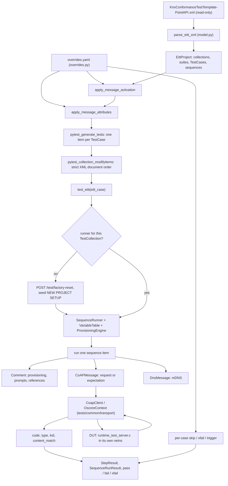
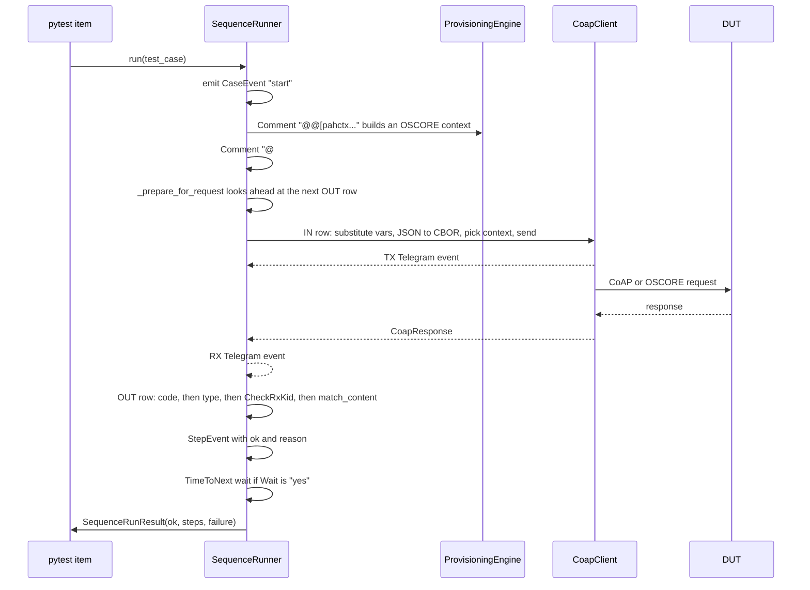

# A tour of the EITT XML interpreter

Audience: KNX IoT / CoAP engineers who know pytest but have never seen this
tier. This is the map; it links rather than repeats. The detailed design is
[`eitt-xml-interpreter.md`](eitt-xml-interpreter.md), the tracker is
[`eitt-interpreter-findings.md`](eitt-interpreter-findings.md), and adopting a
new template revision is [`eitt-template-update.md`](eitt-template-update.md).

## 1. Elevator pitch

KNX ships the official Point API conformance test plan as an XML file that its
certification tool (EITT) executes. The `eitt` tier takes that same file,
`tests/eitt/data/KnxConformanceTestTemplate-PointAPI.xml`, and interprets it
directly: at collection time `pytest_generate_tests` in `tests/eitt/test_eitt.py`
parses the template and emits **one pytest item per `TestCase`**, then plays
each case's telegram sequence over real CoAP/OSCORE against a live device.
Nothing is hand-ported, so adopting a new template revision means dropping in a
new XML file. The hand-written `runtime` tier covers only what the template does
not. Today's template is version 40 of "8/10/5 - KNX IoT Point API Tests":
10 collections, 193 TestCases, minus the six preparation and template cases
listed in `_EXCLUDED_CASE_NAMES` (`test_eitt.py`).

## 2. The big picture



One TestCase, executed:



## 3. The data model

`model.py` is a pure parser: plain dataclasses, no `#VAR` substitution, no
content matching, no comment commands.

| XML element | Python type | What it holds |
|---|---|---|
| `EITT_KnxConformanceTests` | `EittProject` | id, name, version, global `Fields`, collections |
| `TestCollection` | `TestCollection` | name (`"5.1. Discovery"`), collection-scoped `Fields`, suites |
| `TestSuite` | `TestSuite` | name, TestCases |
| `TestCase` | `TestCase` | name, `sequence`, plus `suite_name` and `collection_name` filled in by `EittProject.iter_test_cases` |
| `Comment` | `Comment` | id, `activate`, `text` (which may be an `@`-command) |
| `CoAPMessage` | `CoAPMessage` | direction, method or response code, path, content, and about 25 behaviour attributes |
| `DnsMessage` | `DnsMessage` | mDNS query or expectation |
| `NumberField` / `VariableByteField` | `FieldDef` | variable name, `DefaultValue`, `Locked` |

A real pair of rows, from `5.1.1.1. Multicast Discovery via /.well-known/core`
in the template:

```xml
<CoAPMessage ID="A6656149-..." Activate="yes" TimeToNext="00:00:00.0" CWay="IN"
             Wait="yes" Type="NON" Code="GET" CF="" AcceptedCF="application/link-format"
             IP="Multicast Site-Local" Path=".well-known/core" SecContext="" Secure="no"/>
<CoAPMessage ID="4C9CC2C2-..." Activate="yes" TimeToNext="00:00:05.5" CWay="OUT"
             Wait="no" Type="NON" Code="2.05" CF="application/link-format" IP="BDUT"
             Path=".well-known/core">
  <Content>&lt;&gt;;ep="knx://sn.#BDUT_SERIAL_NUMBER knx://ia...."</Content>
</CoAPMessage>
```

`CWay="IN"` means "into the DUT", so it is what the tool **sends**
(`CoAPMessage.is_request`); `CWay="OUT"` is what the tool **expects to
receive** (`CoAPMessage.is_response`). The parsed objects therefore hold
`code="GET"`, `ip="Multicast Site-Local"`,
`accepted_cf="application/link-format"` on the first, and `code="2.05"`,
`type="NON"`, `content="<>;ep=..."` on the second.
`TestCase.qualified_name` is `"<collection>::<suite>::<case>"` and is the key
everything else uses.

An unknown `<Sequence>` child raises `UnsupportedSequenceItem` at parse time
(`model._parse_sequence`), rather than being skipped. That rule, never let a
step vanish and still report a pass, is the design principle of the whole tier.

## 4. Executing one row (`runner.py`)

### Request rows

`_run_coap_message` dispatches. Before anything else it calls
`_unsupported_attributes` (the fail-closed gate, below). Then:

1. **Path and query.** `_resolve_path_and_query` substitutes `#VAR` tokens into
   the path and each `URLParameter`. A `PatchParameterFn` hook replaces the
   whole query string instead.
2. **Body.** `_resolve_body`. A `PatchContentFn` hook wins first (the SWU
   upload), then a `<Cbor>` element carrying pre-encoded hex for rows whose
   exact wire bytes matter. Otherwise `<Content>` is parsed as JSON and encoded
   to CBOR through `resource_schema.get_schema(path)`, which maps readable JSON
   keys onto the small integer CBOR keys the Point API uses per resource.
   `/auth/at` is special-cased to a bare CBOR array of entry maps, confirmed
   against `traces/5_3.xml`. An unmapped path falls back to `_DEFAULT_SCHEMA`,
   mirroring EITT's own `Default="yes"` key map; an unknown field *name* raises
   rather than guessing.
3. **Destination.** `_resolve_group_destination` turns `IP="<alias>"` into an
   address. `""` and `"BDUT"` mean the configured unicast DUT. The three
   well-known scope aliases go through `_plain_multicast_scope` and become a
   real `multicast_get`. An alias that an `@@[pahdev` command bound to an IPv6
   *multicast* literal, in practice `BDUT-Multi` at
   `[ff35:30:fd11:9988:7766:0:8000:1]:5683`, becomes a genuine group send. An
   alias nobody provisioned raises `UnknownDeviceAlias` and fails the step:
   silently unicasting it is exactly tracker item T13, where 200 group rows went
   to the DUT by unicast, the device accepted them, and the multicast reception
   path those TestCases are named after was never exercised.
4. **Security.** `provisioning.resolve_context(msg.sec_context)` picks the OSCORE
   context by the row's own `SecContext` alias. `_resolve_oscore_overrides`
   translates the adversarial attributes: `SeqNoOffset`, `SeqNoFn="fix"` with
   `SeqNo`, `InvalidAuthTag`, `RndKid`. `_resolve_echo` handles `Echo="sync"`
   (quote back the DUT's last challenge) and `Echo="fix"`.
5. **Send.** `CoapClient.oscore_request(..., dest=group_dest)` for a protected
   row, `multicast_get` for a scope sweep, plain `get` / `post` / `put` /
   `delete` otherwise. On the unicast OSCORE path a non-adversarial request also
   runs `complete_oscore_block2`, because bodies over 512 bytes now split.
   Block2 continuation is deliberately skipped for group rows and for
   adversarial sends, each of which must stay exactly one telegram.

### The derived context for the 4.01 echo challenge

When the tool writes to a group address, the device answers `4.01 Unauthorized`
with a CoAP Echo challenge, protected under a **brand new** sender context whose
ID Context is freshly generated random bytes.
`CoapClient._recv_oscore_response` sees that the response's outer OSCORE kid
context differs from ours and derives a sibling context with
`OscoreContext.with_id_context(...)`, same master secret and salt, before trying
to decrypt. `runner._check_rx_kid` then asserts EITT's `CheckRxKid="yes"` with
`RxKid="random"`: the kid context must be present, non-empty, and different from
the named context's own `id_context`. Any other `RxKid` value fails as
unsupported.

### Response rows

`_expect_response` matches the `OUT` row against what the preceding request
received. Three diversions come first: a group telegram captured by a listener
armed in `_prepare_for_request` (`_expect_group_telegram`), a DUT-originated
unicast telegram (`_expect_unicast_telegram`), and a request the DUT sends *to
us* (`_expect_dut_request`, recognised by the following `UseLastRxToken` row,
not by the code alone). Then, in order:

| Check | Where | Note |
|---|---|---|
| Response code | `_expected_response_codes` | A comma-separated `Code` means "any of these". `overrides.accepted_response_codes` permits certified substitutions. No response at all is reported distinctly from an empty body, and names discarded datagrams when there were any. |
| Message type | `_coap_msg_type_expected` | 1324 active OUT rows say `Type="ACK"`. A planned ACK satisfied by a CON is allowed: that is the RFC 7252 separate-response pattern. |
| `CheckRxKid` | `_check_rx_kid` | See above. |
| `EvalResponseFn` | `hooks.get_hook` | When present it replaces content matching. |
| Body | `content_match.match_content` | `*` wildcard, literal JSON structural match, `/path: value` field checks with `#VAR`, regex and alternation, and `all:` / `opt:` / bare-regex rules over link-format entries. Field values are `fullmatch`ed, not searched. |

A failed active `OUT` row falls back to any directly following
`Activate="no"` `OUT` rows before giving up (`_run_sequence`). That is EITT's
"alternative response" idiom, and the certified reference run passed a device
that way.

### The fail-closed gate

`_unsupported_attributes` runs on every active `CoAPMessage` and returns the
reasons the row cannot be played faithfully; a non-empty list fails the step,
naming row and attribute. It rejects an unexpected `SeqNumMethod`, a finite
`Cycles` count, and any `Observe` or `ObserveValue`. This is tracker item
**F6**: an attribute parsed into the model but never acted on is a TestCase
reporting a pass it never earned. `Secure` is the one documented exception,
declared but unevaluated, with the reasoning written into the code.

The sibling rule is **F9**, `MalformedXmlValue`. `_safe_int`,
`_content_format_code`, `_resolve_crit_option`, `_parse_time_to_next`, `SeqNo`,
`InvalidAuthTag` and `EchoValue` all raise instead of degrading to "no
modifier": a lenient parser turns an adversarial row into a benign one the
device passes by behaving correctly. Both rules are covered without a DUT by
`harness_tests/test_runner_failclosed.py`.

### Timeouts

`_response_timeout` has one precedence, documented at the
`DEFAULT_RESPONSE_TIMEOUT` block comment (tracker **F16**): the row's own
`AckChkTimeOut`, else the `COAP_TIMEOUT` environment variable, else 5.0 s. That
is separate from `TimeToNext`, which is scripted pacing applied by `_apply_wait`
and scaled by `RUNTIME_TEST_TIME_SCALE`. `Wait="no"` means the `TimeToNext` is a
budget rather than a delay, so the runner continues the moment the expected
telegram lands.

## 5. Variables, and where `overrides.yaml` sits

A runnable EITT test is built in three layers, and a template default is not a
value you may trust. See
[`memory/reference-eitt-three-layer-variable-model.md`](memory/reference-eitt-three-layer-variable-model.md).

| Layer | Where it lives | In the interpreter |
|---|---|---|
| 1. Template `Fields` defaults | the read-only XML, global plus per-collection | `VariableTable.__init__` seeds from `FieldDef.default_value` |
| 2. Variable-values JSON | `data/2026-02-25_09-36_EittConformanceTestVariableValues.json`: GLOBAL, then suite, then collection | mirrored into `variables:` in `overrides.yaml` |
| 3. The generated copy | operator edits pushed into a working copy | the same `variables:` section |

`VariableTable.for_collection(project, name, overrides=...)` applies layers 2
and 3 over layer 1. `substitute()` replaces `#NAME` tokens and records anything
unresolved in `self.unresolved`, because an unresolved token is compared against
an expectation holding the same token and so matches itself. `test_eitt.py`
diffs that set per case and fails even an otherwise passing case that used one
(tracker **F5**).

`overrides.yaml` is the single place local deviations live, because the master
template must never be edited. Its sections:

- **`variables:`** holds layers 2 and 3. Motivating example:
  `GENERAL_TIME_TO_NEXT` is 1000 in the template but 500 in the variable-values
  JSON, and it is referenced by 1489 messages, so trusting the template made
  every run sleep twice as long as real EITT does.
- **`accepted_response_codes:`** maps a planned code to codes that may stand in
  for it. Motivated by the KSG "IoT" class decision that a device answering
  "Forbidden" where the test asks "Unauthorized" is also correct;
  `traces/5_3.xml` records five such evaluations in a run that was accepted.
- **`manual_actions:`** maps an `@@` or `@@!` operator prompt to a DUT control
  endpoint by regex on its text, first match wins. `power cycle` becomes
  `POST /test/restart`, `local master reset` becomes `/test/factory-reset`, and
  `check LAST UPDATE value` is a pure human observation with no endpoint. An
  unmatched prompt is a hard failure (`_run_manual_prompt`).
- **`message_attributes:`** corrects a corrupt attribute *value* over the
  read-only template. The live case is 5.5.4.1's `GET fp/g/1` shipping
  `AcceptedCF="r"`, a leftover fragment of `application/cbor`; the certified
  trace records every such GET with the full value.
- **`message_activation:`** records the operator's choice between the template's
  alternative response branches. The template ships section 5.10's pagination
  pairs with the "not supported" 4.00 branch active; this device supports
  pagination and `traces/5_10.xml` shows 2.05, so those rows are flipped.
- **per-case `action:`** is `skip` (excluded, with a reason), `xfail` (runs, but
  a failure does not fail the suite) or `trigger`. Example: the whole 5.4.2
  Observe suite is skipped, and 5.10.1.4 is xfailed because this build registers
  four extra `/test/*` endpoints, so `GET /p` answers `total=9` instead of 5.

A stale or misspelled key in any of these sections is a **collection-time
`RuntimeError`**, not a silent no-op: see `_check_overrides_match_real_cases`
and the unmatched-entry checks around `apply_message_activation` and
`apply_message_attributes` in `test_eitt.py`.

## 6. Preparations and comment commands

The template's own `Test Sequence Preparation` collection holds reusable
TestCases: `NEW PROJECT SETUP`, `AUTH PREPARATION`, `IA PREPARATION`,
`TABLE PREPARATION`, and the two `Upload Block` loop bodies. They are excluded
from collection and reused instead.

- A `Comment` whose text is `@#"Copy of AUTH PREPARATION"` is an **inline
  reference**. `PreparationRegistry.resolve` strips the `Copy of ` prefix (the
  real EITT workflow duplicates the template case) and `_run_inline_reference`
  calls `SequenceRunner.run` recursively on it.
- `@>w"TestCaseName;unlimited"` is a **loop invocation**.
  `_run_loop_invocation` repeats the named case, writing
  `sequence_loop_count.<name>` and reading `sequence_loop_limit.<name>` from the
  variable table, which is exactly the channel the ported SWU hooks use.
- `NEW PROJECT SETUP` contains only provisioning and no CoAP message, so
  `_seed_project_setup` applies it once per collection runner. Without it the
  engine never learns the `BDUT-Multi` alias every group row is addressed to
  (tracker T13).

State sharing follows real EITT. `_runner_for_collection` factory-resets the
device once per `TestCollection`, then shares one `SequenceRunner`,
`VariableTable` and `ProvisioningEngine` across every case in it, in XML
document order. 124 of the template's cases carry no preparation reference of
their own and depend on state left by earlier siblings. That is why a single
case is not independently runnable.

Comment commands are EITT's embedded DSL, and none of them is a no-op.
`_run_comment` dispatches in a fixed order: `@[w` and `@@[w` waits, then `@@[`
provisioning, then `@@` and `@@!` operator prompts, then `@#` references, then
`@>w` loops, then display-only forms (`@[t`, `@[<text>`, `@!`). **Anything else
starting with `@` fails the step** and names the text (tracker F7/F8): a bare
`@@` used to sit in the fall-through, so two real 5.4.1.8 steps never ran.
`provisioning.parse_comment_command` handles `pahdev` (device aliases),
`pahmcast` (multicast groups, including `join=`), `pahctx` (OSCORE material,
accumulated across several comments until a context can be derived), `pahsnc`
(automatic sequence-number sync on or off), `pahdiscover` (a real discovery
sweep across the link-, admin- and site-local scopes) and `MDNS"rqcheck=..."`.
What a command means is settled by EITT's own scheme file,
`data/EITT_KnxCommentCommandsScheme.xml`, read by `comment_scheme.py`, whose
`lookup()` resolves longest-prefix-first so `@@!` cannot be mistaken for `@@`.

Two multi-step flows do not fit the row-by-row model:

- **SWU**, the software update. `hooks.swu_patch_content` and
  `swu_patch_parameter`, plus their `_continue` variants, slice
  `tests/eitt/data/FWUUploadDummySmall.bin` into blocks, track cursor and block
  number in `HookContext.state`, and set the loop limit the `@>w` loop reads.
- **SPAKE2+**. The template's `.well-known/knx/spake` rows embed
  `<TOOL.SHARE_P>` placeholders that only EITT's own closed-source PAKE math can
  fill. `spake_flow.run_spake_handshake` recognises three consecutive
  request/response pairs on that path and drives the real `Spake2PlusClient`
  instead, then installs the resulting "Temporary Key" context through
  `ProvisioningEngine.set_context`.

## 7. What the interpreter deliberately does not do

| Not done | How it shows up | Pointer |
|---|---|---|
| The CoAP Observe option | `_unsupported_attributes` fails any `Observe` row; all six uses sit in the skipped 5.4.2 suite | F6, and the 5.4.2 block in `overrides.yaml` |
| The 5.4.2 suite as a whole | six `action: skip` entries, each with a reason | the suite is titled "Preliminary - Not for Certification"; see also [`eitt-bug-observe-cancel-5422.md`](eitt-bug-observe-cancel-5422.md) |
| `DnsMessage` playback beyond the implemented mDNS paths | a named failure, never a skipped step | `runner.py` module docstring |
| `SeqNoFn="asinrequest"` outside the 4.01 challenge | accepted but not acted on, documented | `runner.py` module docstring |
| Asserting `Secure` on a response | declared but unevaluated; asserting it needs the transport to report whether a reply actually decrypted | F6 |
| `auth/o/replwdo` PUT (5.3.14.1) | `action: skip`; the optional feature is not implemented, and the reference run never executed it either | `overrides.yaml` |
| Multi-IPv6 and the `/p` total (5.10.1.2, 5.10.1.4) | `action: xfail`, so an improvement reports XPASS rather than hiding | `overrides.yaml` |

Anything outside the template is out of scope by construction. If a behaviour
needs covering and the template does not cover it, it belongs in the
hand-written `runtime` tier.

## 8. Running it, and reading a failure

**Docker only.** This tier needs a `dut` network namespace and a veth pair with
ULA `fd11:9988:7766::1` for the DUT and `::2` for the tool, which only the
Docker harness creates (`tests/common/tools/run-local-ci.sh`). A host-native run
silently produces environment-induced failures and takes about four times as
long; the wall clock is the fastest tell.

```powershell
.\tests\common\tools\run-in-docker.ps1 -Tier eitt
.\tests\common\tools\run-in-docker.ps1 -Tier eitt -Section 5.6
.\tests\common\tools\run-in-docker.ps1 -Tier eitt -Section 5.5,5.6 -IncludeUncommitted
```

Use `-Section`, never `-k`. The `--section` option is registered in
`tests/common/fixtures.py` (`pytest_addoption`) and matched by `_in_section` in
`test_eitt.py`, which compares numeric components: `5.6` matches `5.6` and
`5.6.1` but never `5.5.5.6`. `-k` is a substring match, so it drags in unrelated
cases that then run without their sibling preparations and fabricate failures.
Run whole collections for the same reason.

Reading a failure: `test_eitt` prints the failing step's reason plus
`at sequence item: <repr>`, so you get the row's XML id and attributes. Then, in
order: check whether the row is even active in the template and what `traces/`
recorded for it; check
[`memory/reference-eitt-certification-accepted-deviations.md`](memory/reference-eitt-certification-accepted-deviations.md)
before calling anything a device bug; and grep
[`eitt-interpreter-findings.md`](eitt-interpreter-findings.md) for `**OPEN**`.
An `unresolved #VAR(s)` note means an assertion went vacuous and that case's
pass cannot be trusted. `KNX_TEST_DEBUG_GROUP=1` turns on the `[group]`,
`[mdns]` and `[manual]` traces.

`tests/eitt/harness_tests/` tests the interpreter itself: no DUT, no Docker, no
network. Run it with `python -m pytest tests/eitt/harness_tests -q`, or
`run-local-ci.sh --tier harness`.

## 9. Reading order for a newcomer

1. `tests/eitt/README.md` for the layout and the two rules: the template is
   read-only, and the tier runs in Docker.
2. `tests/eitt/interpreter/model.py` for the document hierarchy. Note that it
   interprets nothing and refuses to drop an unknown element.
3. `tests/eitt/test_eitt.py`, starting with the module docstring. It explains
   the preparation and state-sharing model, which is the most surprising thing
   about this tier.
4. `tests/eitt/interpreter/variables.py` for the three layers and why an
   unresolved `#VAR` is tracked rather than raised.
5. `tests/eitt/interpreter/runner.py`, starting at `_run_coap_message`, then
   `_send_request_inner` and `_expect_response`. Read the
   `_unsupported_attributes` and `DEFAULT_RESPONSE_TIMEOUT` block comments.
6. `tests/eitt/interpreter/provisioning.py` for the `@@[pah...` DSL and what is
   deliberately ignored.
7. `tests/eitt/interpreter/overrides.yaml` for every local deviation, each with
   its evidence written next to it.
8. `tests/eitt/harness_tests/test_runner_failclosed.py` for the fail-closed
   rules, executable, in one file.

The GUI in `tests/eitt/gui/` is a second front-end onto the same engine. It
drives the same `SequenceRunner` and consumes the same `events.py` TX/RX bus,
so nothing in this document changes for it. See
[`eitt-gui-plan.md`](eitt-gui-plan.md).

## 10. Glossary

| Term | Meaning |
|---|---|
| **TestCase** | One `<TestCase>` in the template, and one pytest item. Holds a `Sequence` of Comment, CoAPMessage and DnsMessage rows. |
| **qualified_name** | `"<collection>::<suite>::<case>"`. The stable key for pytest ids and for every `overrides.yaml` entry. |
| **preparation** | A reusable TestCase (`AUTH`, `IA` or `TABLE PREPARATION`) invoked inline by an `@#"Copy of ..."` comment and resolved by `PreparationRegistry`. |
| **override** | An entry in `overrides.yaml`: a variable value, an accepted response code, a manual action, a corrected attribute, an activation flip, or a per-case skip, xfail or trigger. |
| **trace** | A run recorded by the real EITT tool, under `tests/eitt/data/traces/`. The ground truth when the template and the device disagree. |
| **variable-values JSON** | EITT's second variable layer, `data/2026-02-25_09-36_EittConformanceTestVariableValues.json`. Mirrored into the `variables:` section of `overrides.yaml`. |
| **key map** | The JSON-to-CBOR integer key table, scoped per resource path. EITT ships `data/EITT_KnxPointAPIResourceKeyMaps.xml`; ours is `resource_schema.py`. |
| **comment command** | EITT's `@`-prefixed DSL inside `<Comment Text="...">`, defined by `data/EITT_KnxCommentCommandsScheme.xml`. Never a no-op. |
| **fail-closed gate** | `_unsupported_attributes`: a row carrying an attribute the interpreter cannot honour fails instead of being played incompletely (F6), alongside `MalformedXmlValue` for unparseable values (F9). |
| **DUT** | Device under test. Here `tests/common/runtime_test_server.c`, running in the `dut` netns with the test-only `/test/*` control endpoints. |
| **s-mode** | KNX group communication over CoAP, written to `/k`, usually as a NON multicast telegram to the group address. |
| **group row** | A `CoAPMessage` whose `IP=` alias resolves to an IPv6 multicast address (`BDUT-Multi`), so the request really goes to the group instead of to the DUT's unicast endpoint. |
| **echo challenge** | The device's `4.01` plus CoAP Echo option answering an s-mode multicast write, protected under a freshly generated random OSCORE ID Context that the client must derive a sibling context for. |
